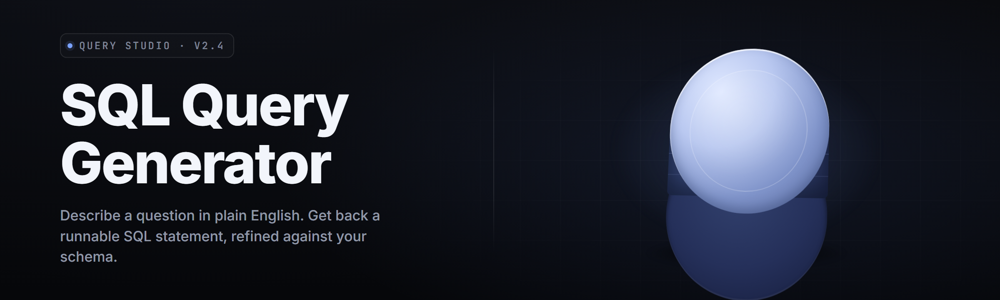

  
  
  

  

  
  
  
  

---

**Turn plain English into production-ready SQL — the fastest AI SQL query generator for 2026.**

Type what you want in a sentence. Get clean, indexed, dialect-correct SQL out the other side. No schema wrangling, no dialect gymnastics, no Stack Overflow archaeology at 2 AM.

---

## 🧠 Tips for best results

- **Name your tables the way you think about them.** "Get me the top 10 customers by revenue last quarter" works because "customers," "revenue," and "quarter" are all recognizable domain signals. Cryptic table names get cryptic SQL.
- **Paste your schema (or import the DDL) before asking.** Accuracy jumps hard once the generator knows your column types, foreign keys, and indexes.
- **State the dialect up front** — PostgreSQL, MySQL, SQL Server, SQLite, Snowflake, BigQuery, Redshift, DuckDB. The generator defaults to Postgres but flips dialects cleanly when told.
- **Ask for the shape you want.** "As a CTE," "as a window function," "as a recursive query," "with a `LIMIT` guard." It honors explicit structural requests better than implied ones.
- **Give it a row-count vibe.** "For a ~50M row events table" changes the plan hint the generator emits versus "for a small lookup table."
- **Iterate in the chat pane, not by re-typing.** Refine ("now add a rolling 7-day average") and the generator keeps context.
- **Review before you run.** `DELETE`/`UPDATE` without `WHERE` gets flagged in the safety pane — read the flag.

---

## 📑 Table of Contents

- [🧪 What is the AI SQL Query Generator?](#-what-is-the-ai-sql-query-generator)
- [🧩 Key Features](#-key-features)
- [🎯 The Problem](#-the-problem)
- [💡 The Solution](#-the-solution)
- [⚡ Quick Start](#-quick-start)
- [🆚 Comparison](#-comparison)
- [🗄️ Schema Intelligence Modules](#️-schema-intelligence-modules)
- [🔤 Dialect Coverage Modules](#-dialect-coverage-modules)
- [🧷 Safety & Linting Modules](#-safety--linting-modules)
- [🖥️ System Requirements](#️-system-requirements)
- [📦 Installation](#-installation)
- [🩹 Known Issues](#-known-issues)
- [❔ FAQ](#-faq)

---

## 🧪 What is the AI SQL Query Generator?

A Windows desktop app that translates natural-language questions into SQL for 11 major dialects, wired directly against your live schema. You describe the result you want; it produces a query you can inspect, lint, explain, and run.

| Term | Explanation |
| --- | --- |
| **Prompt** | The plain-English request you type into the generator pane ("revenue by region, monthly, last 12 months"). |
| **Schema Context** | The DDL + metadata the app indexes so the generator knows your real tables and columns. |
| **Dialect Profile** | The target SQL flavor — Postgres, MySQL, T-SQL, BigQuery, etc. |
| **Validated Query** | The generated SQL after static analysis, linting, and (optional) dry-run cost check. |
| **Explain Plan Preview** | A cost/row estimate fetched from your connected DB before you commit to running. |
| **Safety Pane** | The panel that flags missing `WHERE` on write statements, unbounded scans, and destructive patterns. |

**Why people use it:**

- You stop context-switching to docs to look up window-function syntax.
- It catches obvious footguns (accidental full-table `UPDATE`, missing join predicate) before your production run.
- It keeps a reviewable history of every generated query, so the "how did we build this?" question has an answer.
- It emits dialect-correct SQL by default — no more "`LIMIT` vs `TOP` vs `FETCH FIRST`" hunting.
- It writes queries that mirror your schema's real naming, not generic placeholders.

---

## 🧩 Key Features

| Feature | Description | Benefit |
| --- | --- | --- |
| Natural Language → SQL | Sentence-to-query translation with intent parsing. | No syntax recall required. |
| Live Schema Indexing | Reads information_schema / catalog views to learn your DB. | Generated SQL uses real column names. |
| Dialect Profiles | 11 dialects with a stable profile system. | One prompt, many targets. |
| CTE & Window Builders | First-class support for CTEs, recursive CTEs, window functions. | Modern SQL patterns without a syntax dive. |
| Query Explainer | Rewrites any SQL into a plain-English walkthrough. | Onboard teammates to gnarly joins. |
| Safety Pane | Detects dangerous writes, missing predicates, oversized scans. | Saves you from a bad Friday. |
| Parameterization Helper | Converts literals to bind params for your driver. | Prevents SQL injection before it exists. |
| Diff-Aware Refine | "Now do X" edits the last query in place. | Iterate without retyping. |
| History + Bookmarks | Searchable, tagged local ledger. | Reuse the good ones. |
| Cost Guardian | Optional pre-flight estimate on BigQuery/Snowflake. | No surprise bills. |
| Explanation Overlays | Inline notes on why a plan uses a given join order. | Learning, not just output. |

---

## 🎯 The Problem

- You know *what* you want and spend 20 minutes looking up *how* the dialect spells it.
- Your production schema isn't in the docs the LLM saw in training, so generic AI SQL gets column names plausibly wrong.
- Joins across a 40-table schema mean half your generated queries use a column that doesn't exist.
- Write statements without `WHERE` slip past casual review; the app that should be catching that often doesn't.
- BigQuery and Snowflake pricing punishes naive scans, and you find out after the job runs.
- Parameterization (bind variables for your driver) is the thing you always forget, and it's the thing that matters most for safety.
- It's 2026 — you shouldn't be hand-typing `CASE WHEN` over a schema you already described to a colleague in English.

---

## 💡 The Solution

| Problem | Solution |
| --- | --- |
| Dialect syntax diving | 11 built-in dialect profiles, chosen once, applied everywhere. |
| Schema-blind generation | Live schema indexing that reads your real catalog before the first prompt. |
| Bad column names | Column-name resolver validates every identifier against indexed schema. |
| Missing `WHERE` on writes | Safety Pane hard-flags unbounded `UPDATE` / `DELETE`. |
| Runaway cloud costs | Cost Guardian estimates scan size before dispatch. |
| Manual parameterization | One-click bind-param extraction for major drivers. |
| Retraining teammates | Query Explainer produces a plain-English walkthrough of any SELECT. |

---

## ⚡ Quick Start

1. 🪟 **Extract the archive.** Right-click → Extract All → into a folder of your choice (avoid Program Files; the app writes a small local cache).
2. 🧷 **Run `.exe`.** Double-click the launcher. Windows SmartScreen may show "More info → Run anyway" on first run for unsigned builds.
3. 🔌 **Connect or paste schema.** Either point the app at a live connection string, or paste a `CREATE TABLE` dump into the schema import pane.
4. 💬 **Ask.** Type your question in the prompt box. Choose the dialect, optionally attach a "shape" hint (CTE / window / raw).
5. ✅ **Review, copy, or run.** Inspect the Safety Pane, then copy the query, export as a `.sql` file, or send straight to the connected DB.

---

## 🆚 Comparison

| Aspect | Alternative | This Tool |
| --- | --- | --- |
| Schema awareness | You provide it per prompt | Persistent index built from your live DB |
| Dialect handling | One dialect or plugin churn | 11 first-class profiles incl. DuckDB, Redshift |
| Safety review | Text-only warnings | Static analysis + write-statement gate |
| Cloud cost preview | Manual trial | Cost Guardian pre-flight estimate |
| Refine workflow | New prompt from scratch | In-place diff-aware refine |
| Explainer | Sometimes offered | Always available, works on pasted SQL too |
| History | Session only | Local searchable ledger with tags |
| Parameterization | Manual | One-click bind-param extraction for 6 drivers |

---

## 🗄️ Schema Intelligence Modules

**Introspection & Indexing**

- **Catalog Reader** — Reads `information_schema`, `pg_catalog`, and per-dialect equivalents into a local metadata store.
- **DDL Parser** — Turns pasted `CREATE TABLE` dumps into the same metadata shape as a live index.
- **Relationship Graph** — Builds a foreign-key graph so multi-table joins respect known edges.
- **Column Type Resolver** — Type-aware rendering (dates get date functions, UUIDs get UUID casts).
- **Naming Resolver** — Matches fuzzy mentions ("the customer table") to canonical identifiers.

**Schema-Aware Generation**

- **Join Path Finder** — Suggests shortest join paths between two mentioned entities.
- **Ambiguity Highlighter** — Flags prompts where two tables both plausibly match.
- **Alias Manager** — Emits readable short aliases and keeps them consistent.
- **CTE Factorization** — Detects the same subquery three times and factors it out.
- **Dedup Awareness** — Uses `EXISTS` vs `JOIN` based on cardinality hints.
- **Partition Pruner** — Emits the predicate that lets the planner skip partitions.

**Schema Lifecycle**

- **Index Advisor** — Suggests indexes that would help the generated query.
- **Migration Notes** — If a referenced column doesn't exist, proposes the migration.
- **Schema Diff** — Compares two indexed schemas (e.g., staging vs prod) for discrepancies.
- **View Reconstruction** — Reads views and re-inlines them when useful.

---

## 🔤 Dialect Coverage Modules

**Dialect Profiles**

- **PostgreSQL 12+**
- **MySQL 8**
- **MariaDB 10.6+**
- **SQL Server 2016+ (T-SQL)**
- **SQLite 3.35+**
- **Oracle 19c**
- **Snowflake**
- **BigQuery (GoogleSQL)**
- **Redshift**
- **DuckDB 0.10+**
- **Databricks SQL**

**Cross-Dialect Compilers**

- **`LIMIT` / `TOP` / `FETCH FIRST` Normalizer** — Emits the correct paging form per dialect.
- **Date Function Mapper** — `DATE_TRUNC`, `DATEADD`, `TIMESTAMP_TRUNC` variants unified.
- **String Function Mapper** — `CONCAT`, `CONCAT_WS`, `STRING_AGG`, `LISTAGG`, deterministic per dialect.
- **JSON Access Mapper** — `->`, `->>`, `::jsonb`, `JSON_VALUE`, `JSON_EXTRACT`.
- **Upsert Mapper** — `ON CONFLICT`, `ON DUPLICATE KEY`, `MERGE`, `INSERT OR REPLACE`.
- **Window Function Defaults** — Standardizes `OVER` clause rendering across dialects.
- **CTE vs Temp-Table Choice** — Chooses form based on target engine's known strengths.

---

## 🧷 Safety & Linting Modules

**Static Analysts**

- **Unbounded Write Detector** — Hard-flags `UPDATE`/`DELETE` without a predicate.
- **Full-Scan Warning** — Flags `SELECT *` on wide tables without index path.
- **Type Mismatch Check** — Literal vs column type before you commit.
- **N+1 Shape Detector** — Suggests set forms over per-row forms.
- **Transaction Wrapping** — Adds `BEGIN`/`COMMIT` guidance for multi-statement writes.

**Runtime Helpers**

- **Cost Guardian** — BigQuery/Snowflake pre-flight estimate before dispatch.
- **Row Estimator** — Pre-run row-count estimate from cardinality hints.
- **Dry-Run Emitter** — Produces a valid `EXPLAIN`/`EXPLAIN ANALYZE` prefix per dialect.
- **Parameterizer** — Extracts literals into `?`, `$1`, `:name` per driver.
- **Explain Overlay** — Renders plan diffs beside the query.
- **Rollback Script** — From a generated write, emits the inverse query for review.

> **Note:** The Safety Pane is advisory. It reads a lot less than your production replica does. Always review before running against real data.

---

## 🖥️ System Requirements

| Component | Minimum | Recommended |
| --- | --- | --- |
| OS | Windows 10 (1909+) | Windows 11 22H2+ |
| CPU | Dual-core 2.0 GHz | Quad-core 3.0 GHz+ |
| RAM | 4 GB | 16 GB |
| Disk | 600 MB free | 2 GB free (schema caches) |
| Network | Required first launch | Wired or stable Wi-Fi |
| Runtime | .NET 8 Desktop Runtime | .NET 8 + WebView2 |
| Display | 1280×720 | 1920×1080 |

---

## 📦 Installation

1. **Download and extract.** Save the archive to a folder inside your user profile (e.g., `C:\Users\<you>\Apps\ai-sql-query-generator\`). Right-click → Extract All. Do not extract into a read-only location.
2. **First launch.** Double-click the `.exe`. On unsigned builds, Windows Defender SmartScreen may prompt — click **More info → Run anyway** if you trust the source. The app writes its local index and history under `%APPDATA%\ai-sql-query-generator\`.
3. **Connect or import.** In Settings, either paste a connection string or import a schema dump. Test the connection. If your DB requires a client cert, drop the PEM into the `certs\` folder next to the executable.

After first run, subsequent starts open instantly because the schema index is already resident on disk.

---

## 🩹 Known Issues

| Issue | Solution |
| --- | --- |
| SmartScreen flags the unsigned build | Click "More info → Run anyway"; codesigned builds ship with releases. |
| DuckDB import hangs on 20k+ column schemas | Raise the schema-import timeout in Settings → Advanced. |
| Snowflake cost estimate above 1 TB is slow | Batch the estimate; the pre-flight runs a sampler, not the full job. |
| T-SQL `MERGE` output requires target alias | Explicitly set the alias in the shape hint inline. |
| BigQuery `LIMIT` estimates off by 2x | Use Cost Guardian alone for planning; it queries the planner directly. |
| History search misses accented identifiers | Enable Unicode-normalized indexing under Settings → Search. |

---

## ❔ FAQ

<strong>Is it safe to point this at my production database?</strong>

The generator connects with whatever credentials you give it. Use a read-only role for indexing; keep destructive statements out entirely. The Safety Pane flag on unbounded writes is a guardrail, not a wall — read the flags.

<strong>Does it work with a live connection, or only pasted schema?</strong>

Both. Paste a `CREATE TABLE` dump for offline work, or point it at a live DB for the more accurate index. Live indexing is one-shot on connection; you can re-index any time.

<strong>Which SQL dialects are covered?</strong>

Eleven: PostgreSQL, MySQL, MariaDB, SQL Server, SQLite, Oracle, Snowflake, BigQuery, Redshift, DuckDB, Databricks SQL. Pick one profile per workspace.

**Q:** Does it require admin rights?
**A:** No. It runs in user context. Admin is only needed if you want to install to `Program Files`, which is discouraged.

**Q:** Can it touch databases behind a VPN or bastion?
**A:** Yes — use SSH tunneling. The connection dialog accepts a jump host with a private key; keys stay local under `%APPDATA%`.

**Q:** How is my schema data handled?
**A:** The schema index, history, and bookmarks are stored locally. Index content is sent to the model only when you prompt. Nothing else leaves the machine.

**Q:** What about updates?
**A:** The Help menu has an **Check for updates** action. Update packages are signed and applied into place; your schema cache and history are preserved.

**Q:** Will it generate `MERGE`/upserts, or just `SELECT`?
**A:** All statement types. `SELECT`, `INSERT`, `UPDATE`, `DELETE`, `MERGE`/upsert forms, `CREATE` and `ALTER` (as migration suggestions), and stored-procedure scaffolds.

---

## 📥 Download

  

---

### A short changelog

**v2.4.2** — Added DuckDB profile; improved ambiguity highlighter on schemas with `_id`-suffixed columns.
**v2.4.1** — Fixed a rare crash in the CTE factorizer on three-level nested recursion.
**v2.4.0** — Introduced Cost Guardian sampling for Snowflake; bind-param extraction for the `pgx` and `sqlx` drivers.
**v2.3.5** — Redshift `LISTAGG` mapping corrected; history search performance doubled on >100k entries.

---

<blockquote>
<strong>Heads-up:</strong> Cloud cost estimates are advisory. Verify against the provider's own estimator before committing budget.
</blockquote>

The generator is meant to sit between the question in your head and the query in your editor — collapsing ten minutes of syntax recall into ten seconds of typing. Review what it produces like you'd review a first-year analyst's SQL: quickly, then carefully where it counts. If it saves you one Friday-night incident, it paid for itself.

  

